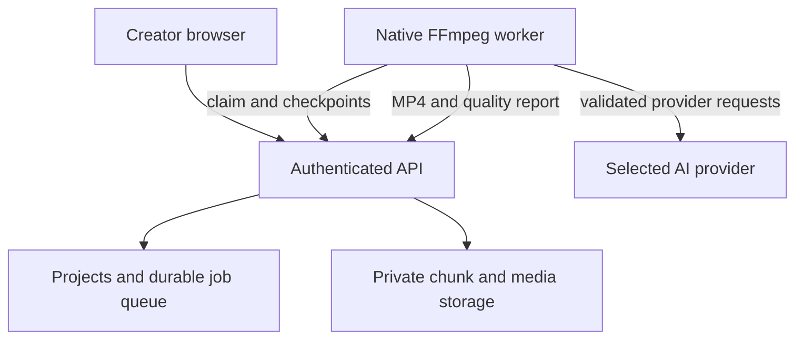

# Architecture

`web/` is a Vite React client. `server/application.ts` is a common Fetch API used by both `server/api.ts` (Node/SQLite/private filesystem) and `server/edge.ts` (Sites Worker/D1/private R2). `server/ports.ts` isolates database and object operations. Native `server/worker.ts` connects over authenticated HTTPS and executes trusted media functions in `server/media.ts`.

Sites dispatch supplies authenticated user headers. Those are consumed only by the hosted adapter, never trusted by the self-hosted HTTP server. Local accounts use PBKDF2-SHA256 with a random salt and 100,000 iterations; session tokens are random, stored hashed, and transmitted in HttpOnly SameSite cookies with Secure in production. Registration is invitation-only in production. The local test-only `DEV_PREVIEW_AUTH=1` switch is ignored in production and is never set on the hosted Site.

Every project query checks ownership. Object paths are internal IDs, not user filenames. Worker access requires a long random operator token, its current exclusive worker lease, and (for a private Site) the existing Sites service credential. Those credentials confer operator-level media access and must stay on the worker server.

Uploads implement tus 1.0 creation, HEAD, PATCH and termination with one reserved asset ID. PATCH accepts at most 8 MiB; the browser sends 4 MiB chunks. Lease comparisons reject concurrent offsets. Each chunk is written before its committed database offset changes. Uncommitted chunks are never presented as completed media. A reselected file resumes from the server offset. Uploads cannot continue after a browser is suspended or closed.

After completion, a durable probe job validates media, creates a thumbnail and computes the first 60 seconds of audio envelopes/silences. Rendering is a separate queued job, acknowledged by ID before work begins. A single worker owns a 90-second renewable lease. It downloads originals by stream, caches immutable sources by ID/size, reuses saved analysis and transcripts, validates a composition, encodes, decodes/checks the output, uploads it, and commits a revision only while the job remains active. Rendered local files are temporary until validation; a database revision is the visibility boundary. A canceled job cannot commit a revision.

The queue lives in SQLite/D1 rather than Redis. Atomic conditional writes enforce one active edit per project, per-user render quotas and provider dispatch counts. On a lost worker lease, render jobs can restart from the saved plan. The final encode restarts; partial MP4s are not resumed. An in-flight provider ledger entry with an unknown response becomes an actionable error instead of an automatic paid retry.

Composition version 1 uses integer milliseconds, fixed 30 fps, source ranges, linked original A/V, audio placements/gains and actual-transcript captions. Source ranges quantize to integer output frames at render time. Intermediates use H.264 with PCM audio; the final AAC encode occurs once to avoid per-cut AAC priming. Source rotation is normalized by FFmpeg's autorotation. There are no speed or pitch changes. Preview and download serve the same validated MP4, not a separate approximate browser composition.

Models return JSON only. Strict validation rejects unknown operations, foreign/missing assets, invalid ranges/dimensions, protected changes and AI cuts inside known speech segments. Whole-clip protection also preserves output location and framing against a previous composition. Provider-authored captions are discarded; trusted source-to-output mapping derives them from timestamps. Plain text and still-frame samples are untrusted media content, not executable instructions.

Music has fixed conservative gain and short fades, dynamic sidechain ducking against original/narration audio, and a final peak limiter. Synchronization compares 20 ms RMS envelopes over 60 seconds and ±10 seconds; confidence >=0.85 and separation >=0.08 are required. It matches only the first video with sound. Incomplete coverage, silence and ambiguous/repeating signals fail with a request to choose an editorial audio role. It is a heuristic, not arbitrary physical synchronization.

Image assets reuse the existing JSON records and composition segments; no schema migration is required. Actual JPEG/PNG/WebP signatures, codec, decoded size and image container are probed server-side. Stills have an editorial display duration rather than a native media duration. The worker loops the single verified image at 30 fps, adds a silent audio bed, and normalizes it through the same composition/render/quality path. Animated formats and text/vector inputs are rejected. Model plans may reference image IDs as visual segments but never execute animation instructions.
